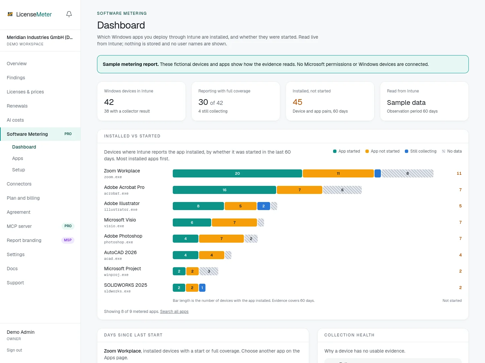
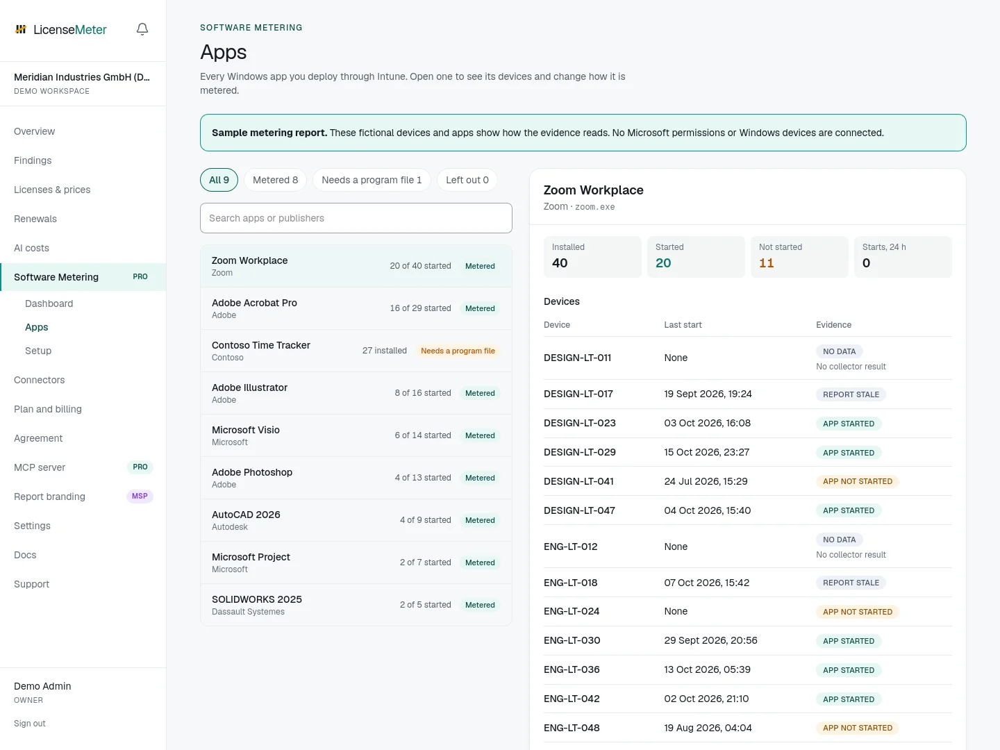

Software Metering shows, for every Windows app you deploy through Intune, the devices where it is installed and whether it was started. Install status comes from Intune. Starts come from a detection script that LicenseMeter generates for your workspace and that you deploy as an Intune Remediation. LicenseMeter reads both live from Intune each time you open or export the report and does not store them. It is optional for each workspace and included in the Pro and MSP plans.

This feature requires installation setup and a Windows pilot. Your existing Microsoft 365 connection continues to use its original permissions. Workspace users who do not enable metering are not asked for metering permissions.

## See it in the sample workspace first

Before any setup, read a complete metering report with fictional data: select **Open the sample tenant** on [LicenseMeter](https://www.licensemeter.com/), then open **Software Metering** in the sidebar. The sample shows 42 fictional Windows devices with installed apps, starts, devices that are still collecting, and one app that is not metered until a program file is entered. No Microsoft permissions or Windows devices are connected, and Setup shows as done. [Explore the sample workspace](/getting-started/sample-workspace/) describes the rest of the tour.

<figure>



<figcaption><p>LicenseMeter sample workspace. All device names, apps and counts shown are demonstration data.</p></figcaption>

</figure>

## What the report means

LicenseMeter meters every Windows app that is assigned in your Intune: Win32, Microsoft Store, WinGet and line-of-business apps, and Microsoft 365 Apps. Visio and Project inside Microsoft 365 Apps are listed as their own apps. Apps installed outside Intune are not listed.

The collector watches program file names, such as `acad.exe` for AutoCAD. Intune rarely records which program an app starts, so LicenseMeter determines it in this order:

1. A program file an Admin entered for the app.
2. The app's Intune detection rule, when it checks for an `.exe` file.
3. LicenseMeter's list of common licensed software, matched on the app name.

Apps without a program file show **Needs a program file** and are not metered until an Admin adds one. Open the app under **Software Metering › Apps** and enter its program file in the app's settings. Admins can also leave apps out there, for example tools that need no license review. The same app assigned several times in Intune appears once.

For each app, the report shows how many Windows devices have it installed, how many of those started it in the observation period, and the number of starts in the last 24 hours. A program that starts copies of itself, such as a browser, counts once per start. Software Metering has four pages in the sidebar: **Dashboard**, which opens with app starts per day across all devices, followed by the evidence charts; **Apps**, to search apps and see each app's devices and starts per day; **Devices**, to see each device's collector status and the metered apps started on it; and **Setup**. Starts per day cover the last 30 days, counted in UTC days on each device.

<figure>



<figcaption><p>LicenseMeter sample workspace. All device names, apps and counts shown are demonstration data.</p></figcaption>

</figure>

A start is evidence that a program file was launched. It does not measure foreground time, productive work, license ownership, or activity on another device or platform. Background starts and other programs with the same file name can affect results. Check the license assignment before taking action. LicenseMeter does not reclaim licenses from this report.

| Evidence | Meaning |
| --- | --- |
| App started | A start falls within the selected period ending on the report date. |
| App not started | The collector reports continuous coverage for the selected 30, 60 or 90 days, with no start in that period. |
| Still collecting | The collector has not yet covered the selected period on this device, or started watching this app later. |
| Not watched yet | The deployed collector does not watch this app yet, for example because it was added to Intune after the collector was generated. |
| No data | No valid output, disabled auditing, collection errors or gaps. |
| Report stale | The report is more than eight days old. |

Missing results never establish that an app is unused. The default observation period is 60 days. Devices outside the collector assignment show no data.

## Prerequisites

- A Pro or MSP plan for the workspace. Without it, LicenseMeter reads no metering results; an Admin can still disable metering.
- A workspace Admin and an existing Microsoft 365 connection bound to the intended tenant.
- An installation operator who has configured the separate metering application below.
- An administrator permitted to grant Microsoft Graph application permissions, normally a Global Administrator or Privileged Role Administrator.
- Supported Windows devices managed by Intune or co-managed with Configuration Manager, with Microsoft Entra join or hybrid join.
- Qualifying Remediations licensing. Microsoft lists Windows Enterprise E3/E5, Windows Education A3/A5, and Windows VDA per user. Check the current [Remediations requirements](https://learn.microsoft.com/en-us/intune/device-management/tools/deploy-remediations) for your deployment.
- Authority within your organization to enable process auditing and collect device-linked activity metadata.

Microsoft's Remediations guidance advises against collecting personal data through scripts. This collector avoids usernames, command lines, document paths, and raw events in its output, but timestamps linked to device identifiers can still relate to employees. Review that guidance and your organization's privacy requirements before deployment. Do not use this report to evaluate individual employee performance.

## Operator setup: separate application

Create a **new** Microsoft Entra application registration for Software Metering. On the hosted service, the service operator does this once. For self-hosting, the installation operator supplies the registration and environment settings.

1. Select accounts in any organizational directory for a multi-tenant deployment.
2. Add a Web redirect URI of `https://YOUR-APP-HOST/api/connect/metering/callback`. Use the public origin configured for your installation.
3. Under Microsoft Graph, add only these **Application** permissions:
   - `DeviceManagementScripts.ReadWrite.All`: find the Remediations package that runs the collector and read its results, and create that package or update its script when an Admin asks for it in Setup.
   - `DeviceManagementManagedDevices.Read.All`: read device identifiers, names and operating systems.
   - `DeviceManagementApps.Read.All`: read the assigned Intune apps and their per-device install status.
4. Remove default permissions that the registration does not need. The only write permission is on scripts, used for LicenseMeter's own collector package.
5. Create a client secret and configure `METERING_CLIENT_ID` and `METERING_CLIENT_SECRET` in the server environment. Keep the secret server-side and rotate it through your normal process.
6. Deploy the database migration and application together. Docker applies committed migrations on startup. The metering migrations add tables for the metering settings and pending consent only; device results are never stored. They enable row-level security and install policies for the existing application and tenant roles. Hosted operators must apply both the table and policy migrations through their approved schema process before serving the new application. Confirm the policies match any custom role configuration.

Do not reuse the sign-in or Microsoft 365 connector application. Do not add these permissions to the base connector. The implementation rejects a reused application ID and access tokens containing additional application roles. Consent granted with `DeviceManagementScripts.Read.All` instead of the write permission keeps working; Setup then only offers the download, and asks to approve the updated permissions to enable creating and updating the package.

Microsoft supports incremental consent for delegated permissions. Application-permission consent using `.default` covers the application's configured permissions. A separate application keeps metering consent optional and independently revocable. See [Microsoft's consent model](https://learn.microsoft.com/en-us/entra/identity-platform/consent-types-developer) and [admin consent endpoint](https://learn.microsoft.com/en-us/entra/identity-platform/v2-admin-consent).

The device and app permissions are read-only; the scripts permission includes write. All three are tenant-wide. LicenseMeter identifies the collector by its script, reads results only from that package, and does not keep any other script. The permission itself is not narrowed: the scripts permission can read other Intune scripts and results. Device reads include metadata for the tenant's managed devices. The Intune install status report can include user names; LicenseMeter requests only the device and install state columns and rejects any response that contains other columns.

## Customer setup

### 1. Enable and consent

Open **Software Metering › Setup** in the workspace navigation and select **Connect Software Metering**. Finish consent in the same browser session, for the tenant already connected to this workspace. LicenseMeter verifies the application's token and read access before accepting the connection.

Consent propagation can take time. If verification fails, wait a few minutes and select **Already approved in Microsoft Entra? Check access**. This also works when a tenant administrator has granted the separate application access directly in Microsoft Entra. The person starting and completing the redirect flow must be an Admin of the same LicenseMeter workspace; invite the consent administrator to the workspace if needed. The ordinary Microsoft 365 connection is independent of this step.

### 2. Enable process auditing

Through your approved Intune settings catalogue or Group Policy, enable **Advanced Audit Policy Configuration > Detailed Tracking > Audit Process Creation > Success**. In Intune, the relevant audit setting may appear as **Audit Process Creation** under **Audit**. Confirm the effective policy on a pilot device; naming and availability depend on your Windows and management configuration.

Command-line collection is not required. Do not enable it solely for this feature. Process auditing increases local Security log volume. Size and retain that log so the collector can read all events between scheduled runs.

The Windows default maximum Security log size is 20 MB, and the oldest events are overwritten first. With hourly runs this is usually enough. On very busy devices, 20 MB can cover about an hour or less, so a delayed or missed run loses events and coverage restarts. If pilot devices keep reporting coverage gaps, increase the maximum size through **Administrative Templates > Windows Components > Event Log Service > Security > Specify the maximum log file size (KB)** in the Intune settings catalogue, or the equivalent Group Policy. 100 to 200 MB is a reasonable starting point. The Event Log service applies a new maximum size after the device restarts. Confirm it with `wevtutil gl Security`.

Use the locale-independent subcategory ID to inspect the effective policy on the pilot device:

```powershell
auditpol /get /subcategory:"{0CCE922B-69AE-11D9-BED3-505054503030}"
```

The collector checks this policy without changing it. It reads process creation event 4688 and audit-policy changes (4719) from the local Security log. See [Audit Process Creation](https://learn.microsoft.com/en-us/previous-versions/windows/it-pro/windows-10/security/threat-protection/auditing/audit-process-creation).

### 3. Deploy the detection script

In **Setup**, step 2, select **Create in Intune** to let LicenseMeter create the Remediations package for you: detection script only, SYSTEM, 64-bit. Choose whether to assign it to all devices hourly, or to assign it yourself in Intune, which is recommended for a pilot group. LicenseMeter writes only this one package and only when you confirm. The action appears in the activity log.

To add it yourself instead, select **Download collector**. LicenseMeter generates **Collect-LicenseMeterUsage.ps1** with the program files of your metered apps built in; the list is visible at the top of the script. Review the script, then create an Intune Remediations package with:

- The downloaded file as the detection script, with no remediation script.
- **Run this script using the logged-on credentials: No**, so it runs as SYSTEM.
- **Run script in 64-bit PowerShell: Yes**.
- An hourly schedule, initially assigned only to a small Windows pilot group. Hourly runs keep the interval between event reads short, so a normally sized Security log does not roll over between runs.
- Signature enforcement consistent with your policy. The downloaded script is unsigned; sign it with a trusted organizational certificate if your policy requires signatures. Packages that LicenseMeter creates do not enforce signatures.

The script exits with code 0 and emits a small JSON report: the started programs with their last start, starts in the last 24 hours and starts per day for the last 30 days, the coverage period, health and the version of its program list. It never reports paths, command lines or user names. It does not remediate devices. Microsoft limits script output to 2,048 characters; the script reports only started programs, and if a device ever exceeds the limit it first drops the per-day counts of the oldest starts, then the oldest starts themselves, and marks the report as truncated, so those apps show no data instead of a false "not started". Do not edit the script.

The first run establishes coverage from that moment. It does not reconstruct past months from a short event log. A protected local checkpoint in `%ProgramData%\LicenseMeter\Metering\usage-v2.json` carries last starts and start counts per hour (24 hours) and per day (30 days) forward across log rollover. Coverage restarts if events were lost before they were read, if the log was reset, or if Process Creation auditing was switched off for more than a few seconds. Intune re-applies audit policies regularly, which switches auditing off and on again within milliseconds; that keeps coverage. The event scan has a 100,000-event limit and a 90-second budget checked between event reads. Initialization, a blocked read, and checkpoint writes can add runtime. Exceeding a scan limit discards that interval with a coverage gap and advances the checkpoint so the next run can recover. Powering a device off does not by itself reset coverage if all intervening events remain available.

### 4. Wait for the first report

LicenseMeter finds the Remediations package that runs the collector by itself, by reading the deployed script. You never select a package. Step 2 of Setup confirms the package it found. If several packages run the collector, choose one under **Settings** on the Setup page, where you can also change the observation period (60 days by default).

Step 3 shows when the first device reports. The **Dashboard** shows its full charts right away and fills them in as devices report. App starts appear as soon as they arrive; until a device has covered the whole observation period, its apps show as still collecting. Starts per day count from the device's first run of the current collector. The report reads the latest results from Intune whenever you open it or export the CSV. A read is reused for up to five minutes; select **Read latest results** to read again immediately.

Verify a known app start, the device identity, the report date, and coverage health. Then expand the assignment. Intune controls when device results become available; LicenseMeter does not remotely run scripts. The first result for a newly assigned device can take several hours to appear in Intune reporting, even after the device has run the script.

Reads are capped at 50,000 returned rows and 500 pages per resource, with bounded request time. Large estates take longer to load because every read queries Intune. Larger estates require an operator-supported strategy before rollout.

### 5. Keep the app list current

When apps are added to Intune or you change program files, devices keep running the collector you deployed. LicenseMeter reads the deployed script, so it knows exactly which apps it watches. Apps it does not watch yet show **Not watched yet**, and Setup lists them. When LicenseMeter can write to Intune, saving an app's settings under **Apps** updates the collector right away (**Save and update Intune**). Otherwise select **Update in Intune** in Setup to replace the detection script in the same package, or download the collector again and replace it yourself. The assignment stays, and devices switch on their next run. Coverage for apps already watched continues; newly added apps start collecting from that run.

When LicenseMeter improves the collector itself, the Dashboard and Setup show that a newer collector is available. Update it the same way. Coverage and last starts carry over.

## Troubleshooting

| Symptom | Check |
| --- | --- |
| Setup is awaiting the operator | Separate metering app environment settings are missing or reuse another application. |
| Consent cannot be verified | All three required application permissions, correct tenant, propagation delay, Intune licensing and access policies. After an update that added a permission, grant consent again. |
| Collector not found in Setup | Create the Remediations package with the downloaded collector as its detection script, in the connected tenant, then select **Read latest results**. |
| No collector result | Device assignment, connectivity, Intune reporting and SYSTEM execution. |
| Enable process auditing | Effective Process Creation Success policy on the device. |
| Still collecting after a gap | Device missed scheduled runs, Security log rolled over before collection (increase its maximum size), Process Creation auditing was switched off, or local state was reset. |
| No starts per day | The device runs an older collector. Update it from Setup; days count from its next run. |
| Collection error | Review the collector's health value in Intune. Wrong scripts, malformed output and output over 2,048 characters are rejected. |
| Program file unknown | Open the app under **Apps**, enter its program file and select **Save and update Intune**. Without write access, update the collector from Setup afterwards. |
| Not watched yet | Download the collector again from Setup and replace the detection script in Intune. |
| Report stale | Device has not supplied a recent valid report. Intune may report unchanged results on a weekly cycle. |
| Results could not be read | Intune or Microsoft Graph was unavailable or limited the request. No results are shown because none are stored; open the report again later. |

## Data and removal

LicenseMeter does not store metering results. Device names and identifiers, app install status, program file names, last starts, start counts (per day for up to 30 days), coverage dates and health are read from Intune when someone opens or exports the report, and are kept in server memory for at most five minutes. LicenseMeter stores only the metering settings: that metering is enabled, the chosen package when several run the collector, the observation period, the consent status, excluded apps, program files entered by Admins, and the program lists of recently generated collectors. The report shows the current Intune results only; it has no history of its own. Last starts and per-day start counts survive between runs through the collector's checkpoint on each device.

The collector reads Security log events locally on the device, and Windows records fields such as the user account and, if enabled, the command line in them. The collector uses only the program file name and start time, and never reports user names, command lines or paths. LicenseMeter never requests user columns from the Intune install report. The report therefore contains no user identities.

To stop the feature:

1. Select **Disable metering**, then confirm. This deletes the workspace's metering settings and pending consent requests, and LicenseMeter stops reading results.
2. Remove the separate metering application's permission grant or enterprise application in Microsoft Entra. Disabling in LicenseMeter does not revoke Microsoft consent.
3. Unassign the detection package in Intune to stop device collection. Results already reported remain in Intune under your control. Remove the local checkpoint through your approved device process if needed.
4. Review the audit policy separately. Other security tools may rely on it, so do not disable it without checking.

Disconnecting the base Microsoft connection or deleting the workspace also deletes the metering settings. Neither action unassigns the Windows collector or revokes the separate application's consent automatically.
