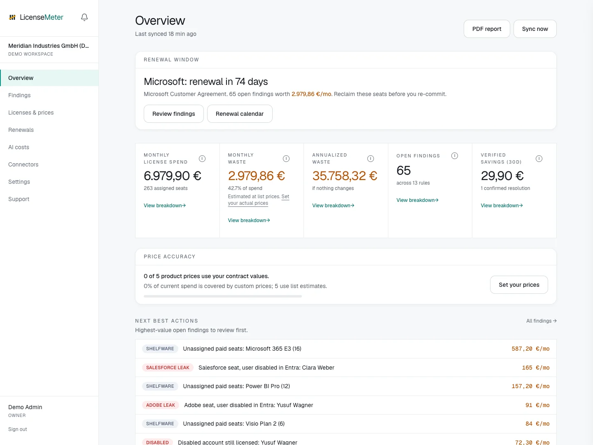

A workspace contains one set of connected data, prices, members, settings and findings. Check the workspace name in the sidebar before reviewing or changing anything.

<figure>

<figcaption>
LicenseMeter sample workspace. All names, costs and findings shown are demonstration data.
</figcaption>

</figure>

## Read the headline metrics

| Metric | Meaning |
| --- | --- |
| Monthly license spend | Billed Microsoft seats multiplied by the configured monthly product prices. Billed seats include paid seats without an assignment and exclude trial seats and free and capacity SKUs. For over-assigned SKUs without trial seats, spend uses the assigned count. |
| Monthly waste | Estimated monthly impact of unresolved findings, based on the price book |
| Annualized waste | Monthly waste multiplied by twelve, assuming nothing changes |
| Open findings | Unresolved findings, including acknowledged items |
| Realized savings (30d) | Monthly value of licenses removed and purchased seats reduced, confirmed by a later sync in the last 30 days. Findings that resolved for other reasons (an exclusion, a changed threshold, the user became active) show as no longer flagged and do not count. Pro adds a savings ledger with monthly and cumulative savings beyond 30 days |

Select **View breakdown** on a metric to inspect its calculation. The figures are estimates, not invoice reconciliation. A resolved finding indicates that its detection condition disappeared; contract terms determine when spend actually falls.

## Decide what to review next

**Next best actions** prioritizes open findings by estimated impact. **Price accuracy** shows how much of the inventory uses your contract prices. **Renewal window** highlights a contract deadline so you can investigate before recommitting seats.

Use **Last synced** to judge data freshness. A recent timestamp does not by itself prove that every provider returned every signal; check [Settings and sync history](/workspace/settings/) for limitations or failures.

For your first assessment, follow [Review your first finding](/getting-started/first-review/) to connect these metrics to a concrete decision and report.

## Multiple workspaces

Use the workspace switcher when available. **Portfolio** summarizes the workspaces you can access; a workspace with a different currency or incomplete prices needs its own context when comparing totals. Your membership and role apply separately to each workspace. On mobile, open the navigation menu to find the switcher. A pending company-domain request does not grant access; follow [workspace invitations and approvals](/workspace/members/).

Next: [Roles and access](/workspace/roles/), [Findings](/findings/), or [Renewals](/renewals/).
